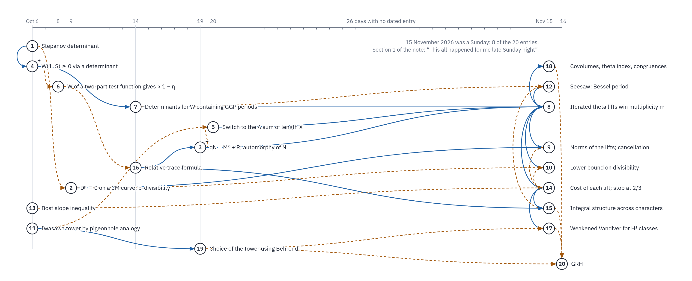

# rh

Author: [Levent Alpöge](https://alpo.ge/cv.pdf)

This repository holds a copy of a Lean 4 project by Levent Alpöge, distributed as the archive `lean.tar.gz` in 14 parts.  Alpöge's four-page note at <https://alpo.ge/remark.pdf> lists the parts in its first footnote.  In that note, Alpöge reports finding, with Claude, a proof of the Riemann Hypothesis and the Generalized Riemann Hypothesis, and formalizing it in Lean without assumptions.  The note's PDF metadata gives a creation date of 2026-11-20.

## Provenance

This copy comes from the parts at `https://alpo.ge/lean.tar.gz.part01` through `https://alpo.ge/lean.tar.gz.part14`, downloaded on 2026-11-20 and joined in numeric order.  The directory `lean/` holds the contents of the joined archive without modification, and the only added files are this README and the image `grh-timeline.png`.  The archive includes no license file.

| File | Bytes | SHA-256 |
|------|-------|---------|
| `remark.pdf` | 245,114 | `3fc97784b71ddd44ff8aa0a177e99622a1c61b13cfa843a0989ee4a7a0cfeb8d` |
| `lean.tar.gz` (joined) | 239,275,554 | `9631b4f020199e580ba86178cb56c6e9b09f690c2369a80dc4334aa93f49c7fc` |

## Status

Publishing this copy did not include building the project or reading its proofs.  The claim of a proof belongs to Alpöge and has not been checked here.  The `Main` library has roots `lean/src/Statements.lean` and `lean/src/Main.lean`, which are the places to start an evaluation of what the project states and whether it depends on `sorry` or added axioms.

| Item | Value |
|------|-------|
| Lean toolchain | `leanprover/lean4:v4.33.1` |
| Mathlib | commit `0df444a360eaa60ab8c11dca51a86af692955474` |
| Lean source files | 175,187 |
| Source size | 983 MB |

## Timeline diagram

Fable (Claude Fable 5.2, an Anthropic model) created this image from the timeline in section 2 of the note.  Horizontal distance is proportional to elapsed days, from 6 October to 16 November 2026.  Each numbered node is one timeline entry, numbered as in the note, and the labels are short paraphrases of the entries.  Entries with the same date share a vertical line, and their vertical order carries no meaning.

The arrows are Fable's conjectures about which entry uses which.  The note states no dependencies, and Alpöge has not reviewed the arrows.  Solid blue arrows follow wording in the note that links two entries.  Dashed brown arrows are inferences from the mathematics that the entries name, and several are weak.  Fable did not read the Lean proofs to make the diagram, so the arrows do not describe the import structure of `lean/`.  The image has two drawing faults: arrows pass under some labels, and the arrows among the entries dated 15 November overlap.
